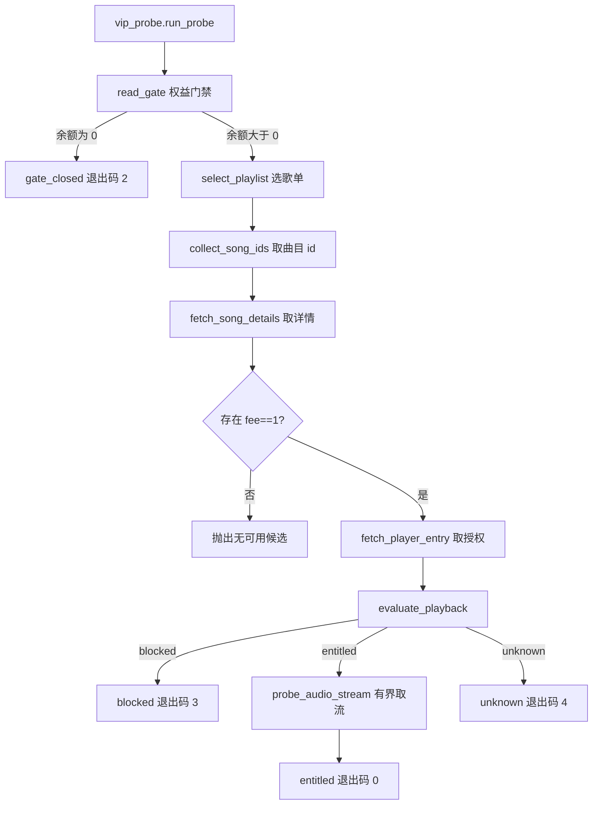

# VIP 播放验证架构设计

## 1. 架构目标

- 只读：只调用查询类接口，不提交任何状态变更。
- 有界：请求次数、候选数量、读取字节数全部有上限。
- 可解释：结论由明确的授权字段推出，不猜测。
- 可测试：核心判定与筛选逻辑可注入假服务，不触网。
- 无泄露：输出只含账号哈希、歌曲公开信息与结论。

## 2. 模块职责

| 模块 | 职责 | I/O 边界 |
| --- | --- | --- |
| `ProbeSession` | 计数、有界重试、只读查询 | 仅查询类接口 |
| `select_playlist` | 挑选候选歌单 | 只读 |
| `collect_song_ids` | 读取歌单曲目 id | 只读 |
| `fetch_song_details` | 批量读取歌曲详情 | 只读 |
| `select_vip_candidate` | 按 `fee` 判定 VIP | 纯内存 |
| `fetch_player_entry` | 读取播放授权条目 | 只读 |
| `evaluate_playback` | 依据授权字段出结论 | 纯内存 |
| `probe_audio_stream` | 单次有界 Range 取流 | 只读，最多 32 KB |
| `run_probe` | 编排上述步骤 | 只读 |
| `account_gate.read_gate` | 权益门禁与账号身份 | 只读，可注入请求器 |

## 3. 流转图



## 4. 接口清单

| 接口 | 用途 | 状态 |
| --- | --- | --- |
| `/api/nuser/account/get` | 登录状态与账号标识 | 可用 |
| `/api/ad/homepage/free/tab/asset` | 免费听剩余时长 | 可用 |
| `/api/user/playlist/` | 账号歌单列表 | 可用 |
| `/api/v6/playlist/detail` | 歌单曲目 id（`playlist.trackIds`） | 可用 |
| `/api/song/detail` | 歌曲 `fee` 判定 VIP | 可用 |
| `/api/song/enhance/player/url` | 播放授权条目 | 可用 |
| `/api/playlist/track/all` | 旧曲目接口 | 服务端拒绝（404） |
| `/api/cloudsearch`、`/api/recommend/songs` | 搜索与推荐 | 服务端拒绝（404） |

不可用接口不作为实现依据，避免依赖会变动的路径。

## 5. 数据结构

### `PlaybackVerdict`

| 字段 | 说明 |
| --- | --- |
| `verdict` | `entitled` / `blocked` / `unknown` |
| `url_present` | 授权条目是否带播放地址 |
| `free_listen_user_consumable` | 免费听资源是否对当前用户可用 |
| `free_listen_remain_time` | 免费听剩余时长 |
| `cannot_listen_reason` | 平台给出的阻断原因，0 或空表示无阻断 |
| `duration_ms`、`bitrate`、`source_fee` | 曲目时长、码率与原始付费标记 |

### 结果 JSON

包含 `mode`、`account_hash`、`gate`、`candidate`、`playback`、`stream`、`requests_made`、`claim_submitted`、`ad_interaction_automated`。不含 Cookie、账号原值与手机号。

## 6. 判定规则

```text
cannotListenReason 非零            → blocked
userConsumable 且 remainTime > 0   → entitled
其余                               → unknown
```

判定只依据平台授权字段；`url_present` 单独记录，不作为放行依据，因为无权益时接口同样会返回地址。

## 7. 资源预算

| 项目 | 上限 |
| --- | --- |
| 单次运行请求数 | 12 |
| 候选歌曲数 | 20 |
| 详情批量 | 20 |
| 取流读取 | 32 KB |
| 取流响应读取硬上限 | 64 KB |
| 单次请求超时 | 12 秒 |
| 失败重试 | 3 次，间隔 2 秒 |

## 8. 安全边界

- 不写入、不导出任何凭证；Cookie 只在进程内存中存活。
- 不调用领奖或广告接口。
- 取流只读前 32 KB，不落盘。
- 失败原样抛出，重试耗尽后抛出带原始异常链的 `RuntimeError`。
