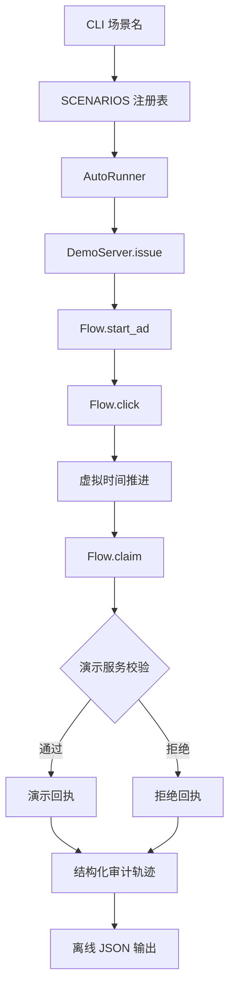

# 免费听离线模拟架构设计

## 1. 架构目标

- 离线：核心流程不包含网络 I/O，也不读取真实账号会话。
- 可调试：每一步记录带虚拟时间的结构化审计事件。
- 可验证：任务规则、流程状态和 CLI 适配层可以独立测试。
- 可扩展：新增场景通过注册表添加配置，避免继续堆叠条件分支。
- Fail-Fast：非法时间、未知场景和不允许的状态转换直接抛出原始异常。

## 2. 模块职责

| 模块 | 职责 | I/O 边界 |
| --- | --- | --- |
| `DemoServer` | 签发任务、校验点击与领取、生成演示回执、维护演示余额 | 纯内存 |
| `Flow` | 管理单任务客户端状态和状态转换 | 纯内存 |
| `ScenarioSpec` | 描述点击时间、领取时间、服务拒绝和重复领取参数 | 不执行 I/O |
| `SCENARIOS` | 以场景名注册 `ScenarioSpec` | 不执行 I/O |
| `AutoRunner` | 按场景自动开始广告、点击、停留、领取并记录审计事件 | 仅调用内存对象 |
| `main` | 解析 CLI 参数并序列化 JSON | stdout |
| `run.ps1` | Windows 入口、退出码透传 | 启动 Python 进程 |

## 3. 流转图



图中所有箭头均为进程内调用。`network_requests` 由结果模型固定为 0，而不是运行失败后的回退值。

## 4. 状态模型

```text
issued
  └─ start_ad → ad_started
       └─ click → clicked
            └─ wait → dwelling
                 └─ claim → waiting_for_receipt
                      ├─ approved → demo_completed
                      └─ rejected → rejected
```

约束：

- 非法状态转换抛出 `ValueError`。
- 点击失败时直接进入 `rejected`。
- 领取失败后保留拒绝回执，便于定位具体原因。
- 成功完成后再次从 `Flow` 领取，直接返回首次回执。

## 5. 数据结构

### `ScenarioSpec`

| 字段 | 类型 | 说明 |
| --- | --- | --- |
| `click_at` | `float` | 首次模拟点击的虚拟时间 |
| `claim_at` | `float` | 自动领取的虚拟时间 |
| `reject_claim` | `bool` | 演示服务是否主动拒绝 |
| `duplicate_claim_at` | `float | None` | 是否在指定时间重复领取 |

### `AuditEvent`

| 字段 | 类型 | 说明 |
| --- | --- | --- |
| `sequence` | `int` | 从 1 开始的稳定顺序号 |
| `virtual_time` | `float` | 事件发生的虚拟时间 |
| `action` | `str` | `task_issued`、`ad_started`、`ad_clicked`、`reward_claimed` 等 |
| `outcome` | `str` | `accepted`、`approved`、`rejected`、`idempotent` |
| `detail` | `str` | 失败原因或演示说明，不包含凭证 |

### `Receipt`

继续使用既有字段，并强制 `demo = true`。只有 `approved = true` 的首次回执可以增加演示余额。

## 6. 场景策略注册表

`SCENARIOS: dict[str, ScenarioSpec]` 是唯一场景来源：

- `success`
- `short-stay`
- `server-rejected`
- `duplicate`

CLI 选择、PowerShell 参数校验、测试参数化和执行器均以该集合为准。Python 侧新增场景时不增加 `if/switch` 链。

PowerShell 的 `ValidateSet` 无法动态导入 Python 常量，本阶段保持同名显式列表，并由测试核对两端集合一致，防止漂移。

## 7. 可观测性与错误透明

- JSON 输出包含场景名、最终状态、状态事件、审计轨迹、回执和余额。
- 拒绝原因原样保留为稳定枚举值。
- CLI 遇到未知场景由 `argparse` 返回非零退出码。
- 非法时间不做修正或静默回退，直接抛出异常。

## 8. 安全边界

- 核心模块不导入 HTTP 客户端，不接受 Cookie、Token 或真实接口 URL。
- 自动执行器只依赖 `DemoServer`，不允许注入真实领奖适配器。
- 审计轨迹必须明确标记虚拟时间和演示动作。
- `account_gate.py` 与离线模拟器单向隔离：门禁不调用模拟器，模拟器也不读取真实会话。
