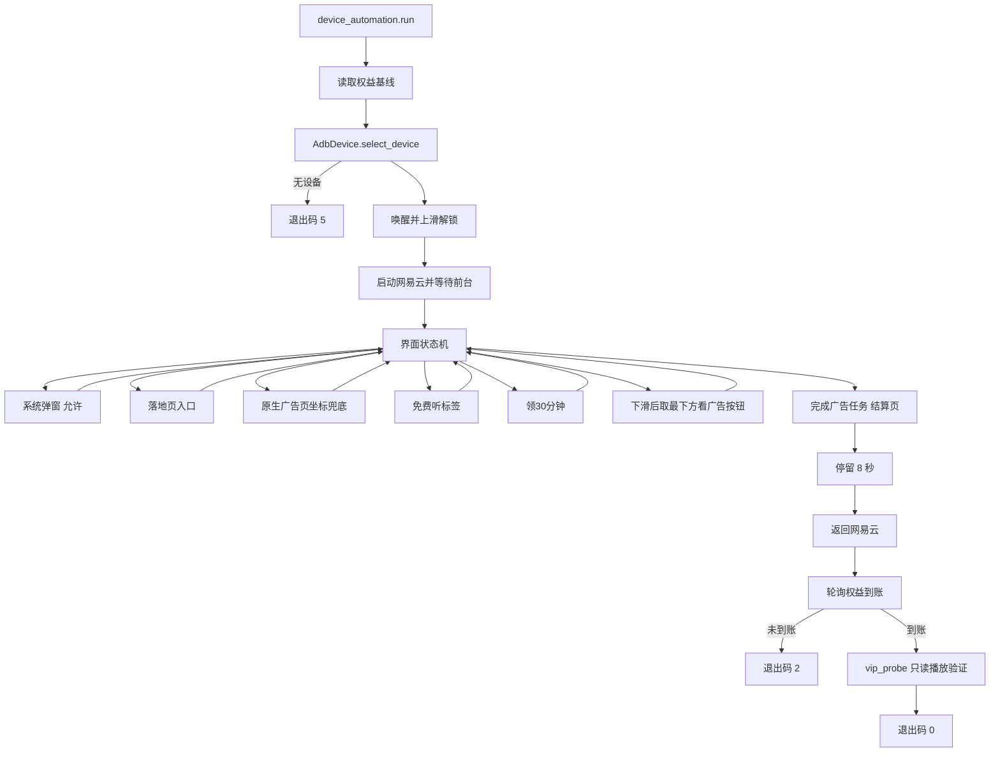

# 手机端自动化架构设计

## 1. 架构目标

- 可调试：每一步都有名字、结果与原始输出。
- 可测试：ADB 层可注入假实现，核心流程不依赖真机。
- 有界：每次等待、轮询与重试都有上限。
- 无泄露：只操作界面，不读取客户端私有数据目录。

## 2. 模块职责

| 模块 | 职责 | I/O 边界 |
| --- | --- | --- |
| `AdbDevice` | 封装 `adb` 命令执行、设备选择、界面 dump、点击与按键 | 子进程调用 adb |
| `UiNode` | 解析界面结构节点，提供文案、描述、resource-id、bounds 与中心点 | 纯内存 |
| `FreeListenFlow` | 编排手机端步骤与到账验证 | 调用 `AdbDevice` 与只读脚本 |
| `account_gate` | 权益轮询 | 只读接口 |
| `vip_probe` | 播放验证 | 只读接口 |

## 3. 流转图

## 3.1 界面状态机

手机端流程按“当前界面上有什么控件”推进，规则按优先级依次匹配：

| 优先级 | 判定条件 | 动作 |
| --- | --- | --- |
| 1 | 出现“允许” | 点击允许，处理系统跳转确认 |
| 2 | 出现“进入落地页查看详情” | 点击落地页入口 |
| 3 | 界面为空且前台是广告页 | 用登记坐标点击落地页入口 |
| 4 | 出现“完成广告任务” | 判定任务已完成，结束推进 |
| 5 | 出现“免费听”标签 | 切换到免费听标签 |
| 6 | 出现“领30分钟” | 打开原生广告任务 |
| 7 | 广告选择页 | 下滑一屏后取最下方的“看广告 免费听” |
| 8 | 以上都不满足 | 若前台不是网易云则结束，否则按返回键重试 |

第 8 条的返回键带停滞保护：前台 Activity 不变即停止并如实报告。

## 3.2 坐标兜底

原生广告页正在播放视频时 `uiautomator` 无法导出界面结构，规则 3 使用登记的稳定坐标 `(612, 2393)` 点击“进入落地页查看详情”。该坐标在架构文档中登记，客户端改版时需同步更新。

## 4. 数据结构

### `UiNode`

| 字段 | 说明 |
| --- | --- |
| `text` | 节点文案 |
| `description` | `content-desc` |
| `resource_id` | 资源标识 |
| `class_name` | 控件类型 |
| `bounds` | `[左,上][右,下]` |
| `center` | 中心坐标，取整 |

### 步骤轨迹 `steps`

| 字段 | 说明 |
| --- | --- |
| `name` | 步骤名 |
| `outcome` | `ok`、`skipped` 或 `failed` |
| `detail` | 命中的文案、等待秒数或原始错误 |

### 结果 JSON

| 字段 | 说明 |
| --- | --- |
| `mode` | 固定 `device_automation` |
| `device` | 设备序列号 |
| `steps` | 步骤轨迹 |
| `baseline_rights` | 任务开始前的免费听剩余时长 |
| `rights_delta` | 任务前后的权益差值 |
| `entitlement_detected` | 权益是否大于 0 |
| `vip_playback_verified` | VIP 播放验证是否放行 |
| `gate` / `probe` | 门禁与探针的原始输出 |
| `exit_code` | 0 通过、2 未到账、3 未放行、5 无设备、6 流程失败 |

不含 Cookie、Token 与设备标识。

## 5. 元素定位策略

1. 精确匹配文案或 `content-desc`；
2. 包含匹配；
3. `resource-id` 精确匹配；
4. 固定坐标兜底（仅限已确认稳定的控件，并在此登记）。

同名文案同时出现在标题与按钮时，按边界宽度过滤掉标题节点（宽度上限 600 像素）。

每次点击前重新 dump，避免缓存过期导致误点。

## 6. 有界与重试

| 环节 | 上限 |
| --- | --- |
| 界面 dump 重试 | 3 次 |
| 等待应用前台 | 30 秒 |
| 状态机推进步数 | 12 步 |
| 点击查找重试 | 6 次，间隔 2 秒 |
| 落地页停留 | 8 秒（不低于任务要求） |
| 返回客户端 | 5 次 BACK，前台不变即停 |
| 权益轮询 | 默认 90 秒，间隔 5 秒 |
| 单次 adb 命令超时 | 60 秒 |

## 7. 安全边界

- 只调用 `adb shell` / `adb exec-out` 的界面与按键类命令。
- 不执行 `pm install`、`settings put`、root 命令。
- 不读取 `/data/data` 下任何文件。
- 不把界面 dump、截图或 logcat 中的标识写入输出；只保留文案与步骤名。
