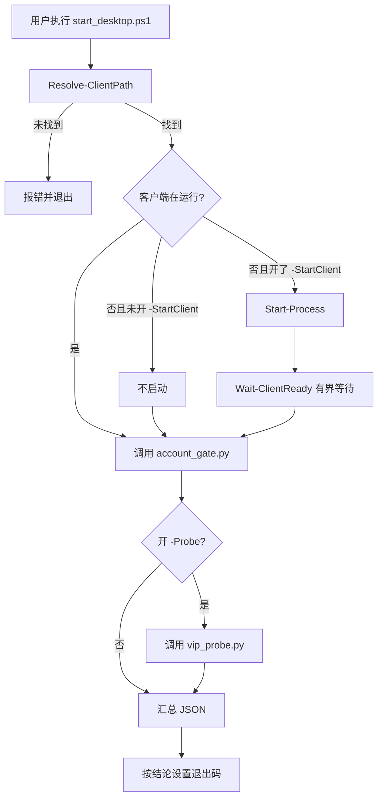

# 桌面启动器架构设计

## 1. 架构目标

- 显式：只在用户主动执行时运行，行为完全可见。
- 可诊断：每一步都有明确的退出码与 JSON 字段。
- 有界：等待时间与重试次数都有上限。
- 隔离：启动器只调用只读脚本，不直接访问网络或凭证。

## 2. 模块职责

| 组件 | 职责 | I/O 边界 |
| --- | --- | --- |
| `start_desktop.ps1` | 编排客户端启动、等待、门禁与探针 | 启动进程、读取子进程输出 |
| `Resolve-ClientPath` | 解析客户端可执行文件 | 只读文件系统与进程表 |
| `Wait-ClientReady` | 有界等待进程出现 | 轮询进程表 |
| `Invoke-ReadOnlyScript` | 以 JSON 方式调用只读 Python 脚本 | 子进程 stdout |
| `account_gate.py` | 权益门禁 | 只读接口 |
| `vip_probe.py` | 播放验证 | 只读接口 |

## 3. 流转图

## 4. 数据结构

### 摘要 JSON

| 字段 | 说明 |
| --- | --- |
| `client.path` | 解析出的客户端路径，未找到为 `null` |
| `client.running` | 执行前客户端是否已在运行 |
| `client.started` | 本次是否启动了客户端 |
| `client.ready` | 等待后进程是否可见 |
| `gate` | `account_gate.py` 的输出，失败时为 `null` |
| `probe` | `vip_probe.py` 的输出，未执行或失败时为 `null` |
| `exit_code` | 汇总退出码 |

### 退出码

| 退出码 | 含义 |
| --- | --- |
| 0 | 门禁放行，且（未跑探针或探针放行） |
| 2 | 门禁未放行，权益为 0 |
| 3 | 探针判定为 `blocked` |
| 4 | 探针判定为 `unknown` |
| 5 | 客户端路径无法解析 |
| 6 | 只读脚本执行失败 |

## 5. 路径解析顺序

1. `-ClientPath` 显式参数。
2. 运行中进程的 `Path`。
3. 候选安装路径列表。

任一环节失败都返回空值，由上层如实报错，不做猜测式回退。

## 6. 有界等待

- 等待间隔 1 秒。
- 最长等待由 `-WaitSeconds` 指定，默认 60 秒。
- 等待超时返回 `ready = false`，流程继续并在摘要中如实体现。

## 7. 安全边界

- 不写注册表、不建计划任务、不装系统服务。
- 不读取或输出客户端私有文件；只读脚本自行处理会话。
- 只读脚本的输出原样进入摘要，不做二次加工，避免引入凭证字段。
- 探针默认关闭，避免在未授权意图下发起额外请求。

## 8. 兼容与依赖

- 依赖 PowerShell 7；`powershell.exe` 仅为兼容组件名，不作为入口。
- Python 脚本依赖 `cryptography`，由 `.venv` 提供。
